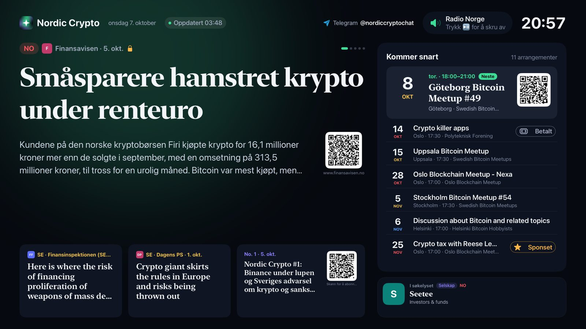
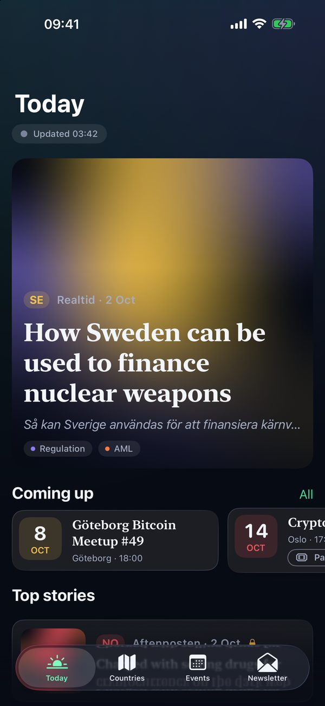
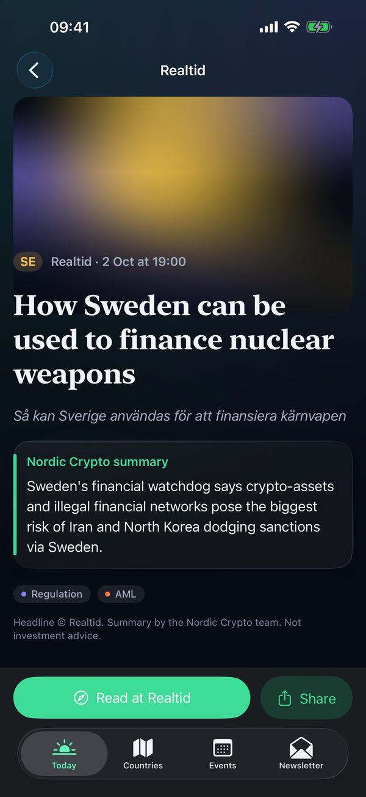
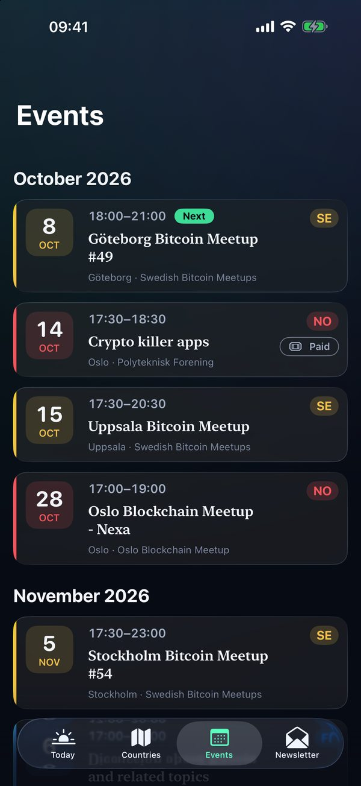
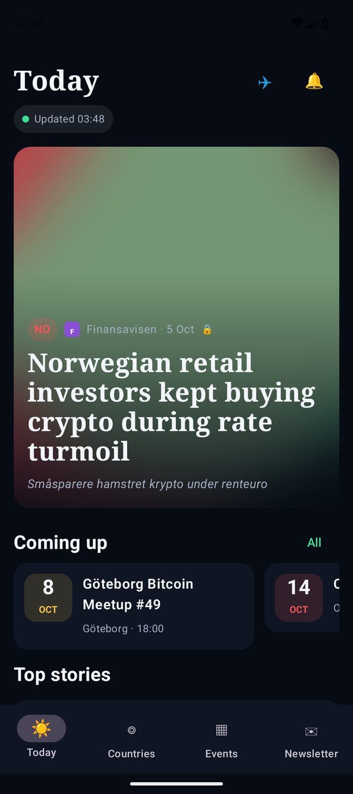
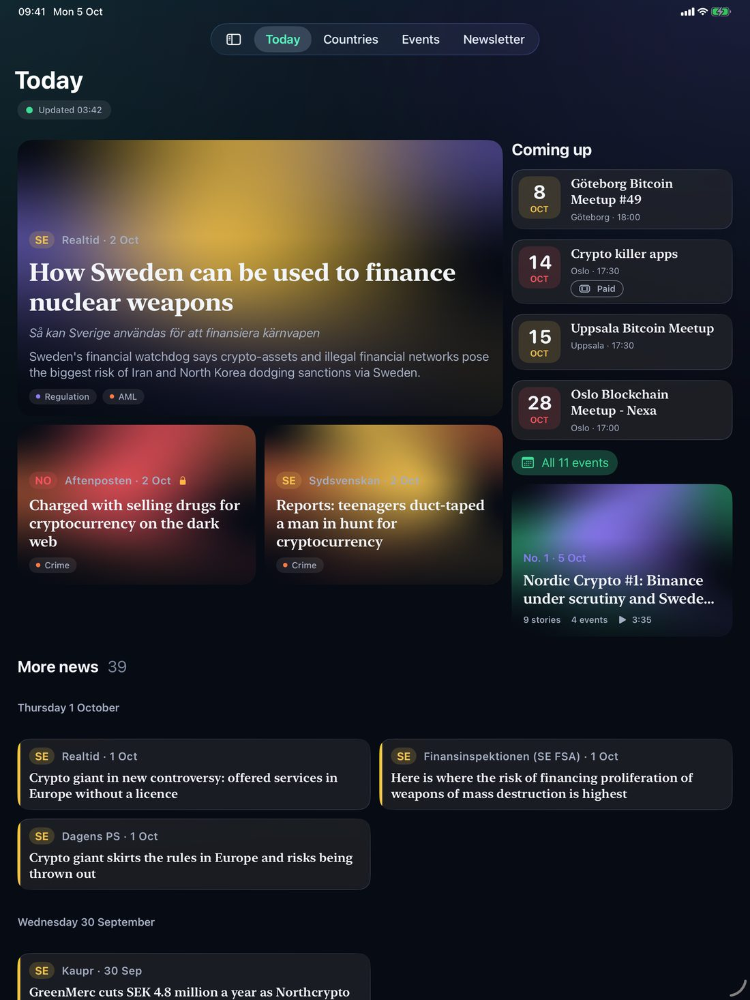
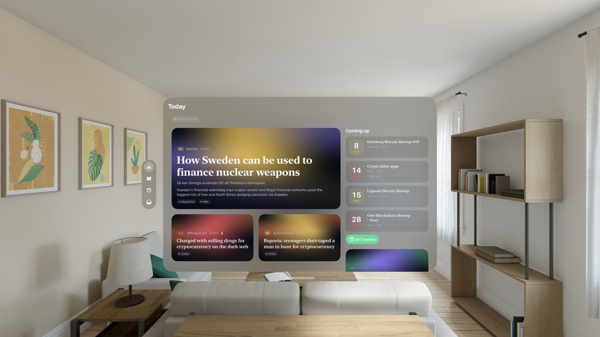
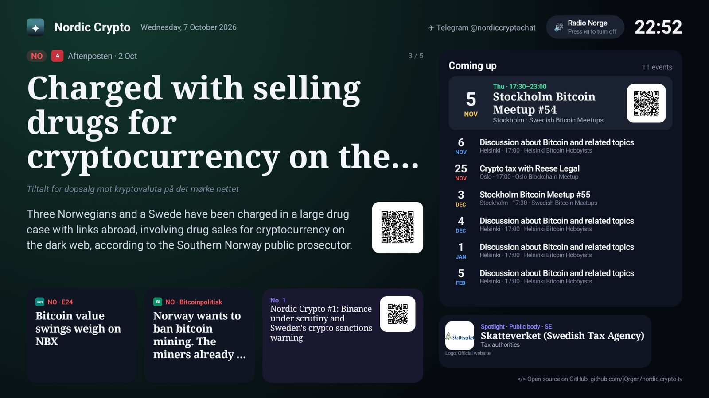

# Nordic Crypto

[](https://github.com/jQrgen/nordic-crypto-tv/actions/workflows/testflight.yml) [](https://github.com/jQrgen/nordic-crypto-tv/releases) [](https://github.com/jQrgen/nordic-crypto-tv/actions/workflows/build.yml) [](https://github.com/jQrgen/nordic-crypto-tv/actions/workflows/android.yml) [](https://github.com/jQrgen/nordic-crypto-tv/releases) [](https://github.com/jQrgen/nordic-crypto-tv/actions/workflows/android-listing.yml) [](https://github.com/jQrgen/nordic-crypto-tv/commits/main) [](https://github.com/jQrgen/nordic-crypto-tv/graphs/commit-activity) [](https://github.com/jQrgen/nordic-crypto-tv/issues) [](https://github.com/jQrgen/nordic-crypto-tv/pulls) [](https://github.com/jQrgen/nordic-crypto-tv/graphs/contributors) [](https://github.com/jQrgen/nordic-crypto-tv) [](https://github.com/jQrgen/nordic-crypto-tv) [](https://github.com/jQrgen/nordic-crypto-tv) [](https://github.com/jQrgen/nordic-crypto-tv)
[](https://github.com/jQrgen/nordic-crypto-tv/blob/main/LICENSE) [](https://github.com/jQrgen/nordic-crypto-tv/releases/tag/android-latest) [](https://github.com/jQrgen/nordic-crypto-tv/releases) [](https://github.com/jQrgen/nordic-crypto-tv/stargazers) [](https://github.com/jQrgen/nordic-crypto-tv/forks) [](https://github.com/jQrgen/nordic-crypto-tv/watchers)
      
[](https://www.swift.org) [](https://developer.apple.com/xcode/swiftui/) [](https://kotlinlang.org) [](https://developer.android.com/compose) [](https://github.com/yonaskolb/XcodeGen)
[](https://testflight.apple.com/join/nQ2fpjZn) [](https://github.com/jQrgen/nordic-crypto-tv/releases/tag/android-latest) [](https://nordiccrypto.no) [](https://nordiccrypto.no/api/) [](https://t.me/nordiccryptochat)  [](https://nordiccrypto.no/privacy/) 

**The Nordic crypto news desk on every screen you own.** Bitcoin, crypto and blockchain news from
Norway, Sweden, Denmark, Finland and Iceland, summarised by people, in your language, on Apple TV,
iPhone, iPad, Mac, Apple Vision Pro and Android.



## Why Nordic Crypto

Nordic crypto news is scattered over dozens of newspapers, regulators and blogs in five languages,
half of them behind paywalls. Nordic Crypto reads them all and gives you one calm front page:

- **Every story, explained.** Each headline comes with a short summary written by the Nordic Crypto
  team, a link to the original source and the outlet's logo. Drafts are checked before anything is
  published.
- **Your language.** The interface speaks 21 languages; summaries come in English, Norwegian
  (bokmål and nynorsk), Swedish, Danish, Finnish and Icelandic.
- **What's on.** Meetups, conferences and talks across the Nordics, with dates and places.
- **Who's who.** A spotlight on the people, companies, regulators and university courses that shape
  Nordic crypto.
- **A screen that stays on.** On Apple TV and Android TV the app is an information screen for the
  office, the meetup or the living room: lead stories, the agenda and the spotlight rotate on their
  own while Radio Norge plays in the background (Play/Pause turns it off).
- **Private by design.** No account, no tracking, no ads. Notifications for new stories are opt-in
  push notifications: our push server keeps only the device's push token, the chosen countries and
  the language, and forgets them when you turn notifications off ([how it works](docs/push.md)). When
  the push server cannot be reached, the app checks for new stories on the device instead.

Not investment advice. Headlines belong to their publishers.

## Try it

[](https://testflight.apple.com/join/nQ2fpjZn)
[](https://github.com/jQrgen/nordic-crypto-tv/releases/download/android-latest/nordic-crypto.apk)

- **TestFlight (iPhone, iPad, Mac, Vision Pro, Apple TV):** https://testflight.apple.com/join/nQ2fpjZn
  Open the link on the iPhone, iPad, Mac or Apple Vision Pro and install TestFlight when asked; every
  change merged to `main` becomes a new TestFlight build on all of them.
  - **On Apple TV:** install the free [TestFlight app](https://apps.apple.com/app/testflight/id899247664)
    from the App Store on the Apple TV (tvOS 18 or later), then open the
    [signup link](https://testflight.apple.com/join/nQ2fpjZn) on an iPhone, iPad or Mac signed in to the
    same Apple Account and accept the invitation. Nordic Crypto then shows up in TestFlight on the
    Apple TV, ready to install.
- **Android APK (phone, tablet, Android TV):** the [latest build](https://github.com/jQrgen/nordic-crypto-tv/releases/tag/android-latest)
  from CI, updated on every change. Open it on the device and allow installs from your browser. On
  Android TV, install it with a file manager or `adb install nordic-crypto.apk`.
- **Community:** [@nordiccryptochat](https://t.me/nordiccryptochat) on Telegram
- **Website and API:** [nordiccrypto.no](https://nordiccrypto.no)

## Screenshots

| iPhone | | | Android |
|---|---|---|---|
|  |  |  |  |

| iPad | Apple Vision Pro |
|---|---|
|  |  |

| Android TV |
|---|
|  |

## What's in the box

| Platform | What you get |
|---|---|
| iPhone, iPad | Today, Countries, Events and Newsletter tabs; story and event pages that open the source; push notifications per country |
| Mac | The same in a window with a sidebar, a menu bar menu with the latest headlines, push notifications per country |
| Apple Vision Pro | The iPad layout in a glass window; the newsreel opens in its own window; push notifications per country |
| Apple TV | The "Kveldsnytt" information screen: lead story, agenda, spotlight, Radio Norge |
| Android phone, tablet | Today, Countries, Events and Newsletter, push notifications per country |
| Android TV | The same information screen as Apple TV, with Radio Norge |

All of it is built on the open [Nordic Crypto data API](https://github.com/jQrgen/nordic-crypto) (`/api/v1/`).

## Build it yourself

### Apple (SwiftUI, one multiplatform target)
```sh
brew install xcodegen
xcodegen generate                   # or scripts/xcodegen.sh: the pinned XcodeGen that CI uses
open NordicCrypto.xcodeproj
```
- Tests: `xcodebuild test -scheme NordicCrypto -destination 'platform=tvOS Simulator,name=<sim>'`
  (pull requests build all four Apple platforms and run the unit tests on iOS and tvOS simulators:
  [Build workflow](.github/workflows/build.yml), no secrets)
- Icons and Top Shelf art: `python3 support/make_brand_assets.py`
- Translations: `python3 support/translations.py` writes `NordicCrypto/Localizable.xcstrings`
- App Store listing and screenshots: see `support/appstore/`

### Android (Kotlin, Jetpack Compose)
```sh
cd android
./gradlew :app:assembleDebug        # app/build/outputs/apk/debug/app-debug.apk
```
The Android app reads the same `Localizable.xcstrings`, so every platform says the same thing.
Release builds are signed with the key named in `android/keystore.properties` (not in the repo).
The [Android workflow](.github/workflows/android.yml) builds a signed APK and app bundle (AAB) on
every push to `main` and publishes both to the `android-latest` release. When the repository secret
`PLAY_SERVICE_ACCOUNT_JSON` holds a Google Play service-account key with release permission for
`no.cryptonordic.app`, it also uploads the AAB to Google Play internal testing (as a draft while the
app is still a draft in Play Console). Version codes start above `ANDROID_VERSION_CODE_OFFSET`
(default 100), because version code 1 was uploaded by hand. One-time setup:
`gh secret set PLAY_SERVICE_ACCOUNT_JSON --repo jQrgen/nordic-crypto-tv < service-account.json`.

The Google Play store listing lives in `android/fastlane/metadata/android/` (English and Norwegian
Bokmål texts; icon, feature graphic, TV banner and screenshots for phone, 7-inch and 10-inch tablet
and Android TV). The [store listing workflow](.github/workflows/android-listing.yml) uploads it with
fastlane `supply` whenever it changes on `main`, using the same secret. Category, privacy policy
(https://nordiccrypto.no/privacy/), Data safety, content rating and ads are set once in Play Console.

### Push notifications
[`push/`](push/) is the push server, a Cloudflare Worker that polls the API every five minutes and
sends one notification per new story through APNs (iPhone, iPad, Mac, Vision Pro) and Firebase Cloud
Messaging (Android) to the devices that chose that story's country. Design, data kept, deployment and
the one-time setup (`scripts/setup-push-secrets.sh`) are in [docs/push.md](docs/push.md). Tests:
`cd push && npm ci && npm test`. The [Push server workflow](.github/workflows/push.yml) tests every
change and deploys `main` once the Cloudflare token is set.

### Data
The apps try `https://nordiccrypto.no/api/v1/` first, then the older addresses. The last good
response is cached, and a snapshot of the API ships with the apps, so the first launch and offline
use always show content. `support/refresh_snapshot.sh` refreshes it.

## Deploying to TestFlight
Every push to `main` builds the one multiplatform target for **iPhone and iPad, Apple TV, Apple Vision
Pro and Mac** on GitHub-hosted Macs (Xcode 27.0, one job per platform), signs each with
[fastlane match](https://docs.fastlane.tools/actions/match/) and uploads it to TestFlight
([TestFlight workflow](.github/workflows/testflight.yml), lanes in `fastlane/Fastfile`). Each build then
goes to the internal group `internt` and to the external group `Beta` (the public link above), with
"What to Test" taken from the commit message. All platforms of a run share one build number: the
workflow run number + 10 (variable `BUILD_NUMBER_OFFSET`), raised above App Store Connect's latest build
if needed; the version is `MARKETING_VERSION` in `project.yml`. A failing platform does not stop the
others. If another build of the same platform and version is still in Beta App Review, the new build
stays with internal testers and the job stays green with a warning. Pull requests only get the
unsigned [Build workflow](.github/workflows/build.yml) and never see secrets.

One-time setup (personal team `YQBXSUUVJD`, never the Bitcoin Unlimited team): with `gh` logged in as
jQrgen and the match password in the login keychain (service `nordic-crypto-wallet-match`, from the
wallet's setup), run from a checkout of this repo:
```sh
bash scripts/setup-signing-github.sh --key-id <KEY_ID> --issuer-id <ISSUER_ID> --p8 <path/to/AuthKey_KEY_ID.p8>
```
It stores the App Store Connect API key and the match password as repository secrets, runs
`fastlane match appstore` once each for `--platform ios` (the iOS profile also signs visionOS),
`--platform tvos` and `--platform macos` (plus a Mac Installer Distribution certificate) for
`no.cryptonordic.tv` in `jQrgen/nordic-crypto-wallet-certificates`, so CI stays readonly, adds a
read-only deploy key for that repo (secret `MATCH_GIT_PRIVATE_KEY`) and sets the variables
`APPLE_TEAM_ID`, `MATCH_GIT_URL` and `MATCH_GIT_BRANCH`. Until then the TestFlight workflow skips with
a notice. To deploy by hand: `gh workflow run testflight.yml --ref main`.

## Licence and contributing
MIT, see [LICENSE](LICENSE). Issues and pull requests are welcome. The news data comes from the
[Nordic Crypto API](https://github.com/jQrgen/nordic-crypto) (also MIT); headlines belong to their
publishers. Radio Norge is a third-party stream and is not covered by this licence. Signing keys,
App Store Connect keys and Play upload keys are never part of this repository.
